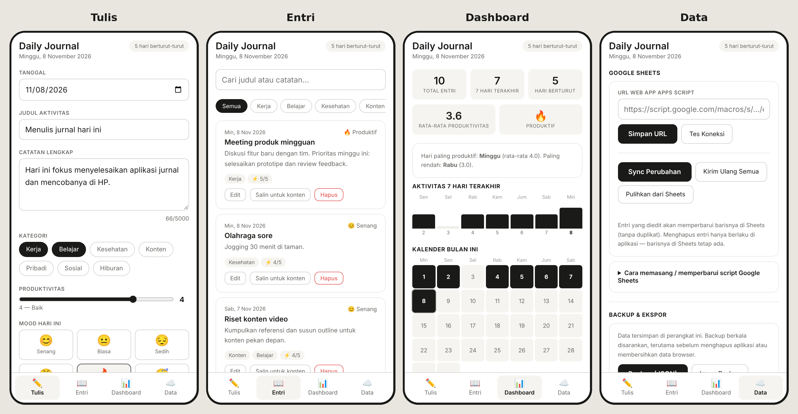

# Daily Journal

Jurnal harian yang sederhana, gratis, dan bisa dipakai siapa saja. Catat aktivitas, mood, dan tingkat produktivitasmu setiap hari, lalu lihat polanya di dashboard. Data tersimpan di HP-mu sendiri.

*English: a simple, free, offline-first daily journal (web app + Android APK). Track activities, mood and productivity, see your patterns on a dashboard, and optionally sync to your own Google Sheet.*



## Fitur
- **Tulis** jurnal dengan judul, catatan, kategori, skor produktivitas (1–5), dan mood berlabel (Senang, Biasa, Sedih, Frustrasi, Produktif, Lelah).
- **Entri:** cari, filter per kategori, edit, hapus, dan "Salin untuk konten" untuk dijadikan bahan postingan.
- **Dashboard:** streak harian, kalender bulanan, grafik 7 hari, tren produktivitas 30 hari, distribusi mood dan kategori, serta hari paling produktif.
- **Google Sheets (opsional):** sinkron ke spreadsheet milikmu sendiri tanpa duplikat, dan bisa dipulihkan dari Sheets.
- **Backup dan impor** (JSON), serta ekspor CSV.
- **Pengingat harian** (di aplikasi Android).
- Jalan **offline**, mengikuti mode terang/gelap HP.

## Privasi
- Data jurnal disimpan **hanya di perangkatmu** (penyimpanan lokal aplikasi/browser). Tidak ada akun, server, iklan, atau pelacakan.
- Data hanya keluar dari perangkat jika **kamu** mengaktifkan sinkron Google Sheets, dan itu ke spreadsheet milikmu sendiri.
- Karena data ada di perangkat, **menghapus aplikasi atau membersihkan data browser akan menghapus jurnal**. Rutin gunakan *Backup (JSON)* atau sinkron ke Sheets.

## Cara memakai

### A. Dari browser HP (tanpa instal APK)
1. Buka versi web aplikasi ini di Chrome Android. Jika sudah dipublikasikan lewat GitHub Pages, alamatnya `https://NAMA-AKUN.github.io/daily-journal/` (lihat bagian *Menerbitkan versi web*).
2. Menu ⋮ → **Pasang aplikasi / Add to Home screen**.

### B. Pasang APK Android
1. Buka halaman **[Releases](../../releases)** repository ini di HP.
2. Unduh `daily-journal.apk`, lalu buka file-nya.
3. Izinkan "pasang aplikasi dari sumber tidak dikenal" untuk browser yang dipakai. Jika muncul peringatan Play Protect, pilih *Detail → Tetap instal*. Peringatan ini muncul karena aplikasi tidak dari Play Store.

## Sinkron ke Google Sheets (opsional)
1. Buat Google Sheet baru → **Extensions → Apps Script**.
2. Hapus kode bawaan, tempel isi [`apps-script.gs`](apps-script.gs), lalu **Save**.
3. **Deploy → New deployment → Web app**. *Execute as*: Me. *Who has access*: Anyone. Salin URL yang berakhiran `/exec`.
4. Di aplikasi: tab **Data** → tempel URL → **Simpan URL** → **Sync Perubahan**.

Setelah memperbarui script di kemudian hari, gunakan **Deploy → Manage deployments → pensil → New version** agar URL tidak berubah.

> Siapa pun yang memegang URL `/exec`-mu bisa menulis ke sheet itu. Jangan bagikan URL tersebut.

## Membangun sendiri

Struktur: kode aplikasi ada di `www/` (HTML/CSS/JS biasa, tanpa framework). Folder `android/` adalah proyek [Capacitor](https://capacitorjs.com/).

**Lewat GitHub (tanpa Android Studio):** fork repository ini → tab **Actions → Build APK → Run workflow**. Hasilnya muncul di **Releases**.

**Lewat komputer** (Node.js 22+, JDK 21, Android SDK):
```
npm install
npx cap sync android
cd android && ./gradlew assembleDebug
```
APK ada di `android/app/build/outputs/apk/debug/app-debug.apk`.

### Tanda tangan APK (disarankan jika kamu membuat build sendiri)
Tanpa kunci, tiap build memakai kunci debug yang berbeda, sehingga APK baru **tidak bisa menimpa** APK lama dan kamu harus uninstall dulu (data lokal hilang kecuali sudah di-backup). Agar update bisa menimpa:
1. Buat kunci sekali saja (simpan baik-baik, jangan pernah di-commit):
   ```
   keytool -genkeypair -keystore release.keystore -alias journal -keyalg RSA -keysize 2048 -validity 10000
   ```
   Gunakan alias `journal` dan satu kata sandi yang sama untuk keystore dan key.
2. Di repository-mu: **Settings → Secrets and variables → Actions → New repository secret**:
   - `ANDROID_KEYSTORE_BASE64` = isi `base64 -w0 release.keystore`
   - `ANDROID_KEYSTORE_PASSWORD` = kata sandi tadi
3. Jalankan ulang workflow. Semua build berikutnya memakai kunci yang sama.

### Menerbitkan versi web
Folder `www/` adalah situs statis (wajib HTTPS agar bisa dipasang sebagai aplikasi).
1. Di repository: **Settings → Pages → Build and deployment → Source: GitHub Actions**.
2. **Actions → Deploy web version → Run workflow**.
3. Alamatnya muncul di hasil workflow, biasanya `https://NAMA-AKUN.github.io/daily-journal/`.

Setiap kali isi `www/` berubah, jalankan workflow itu lagi. Atau unggah folder `www/` ke hosting statis lain (Netlify, Cloudflare Pages).

## Berkontribusi
Masukan dan perbaikan sangat diterima lewat Issues atau Pull Request. Ide yang masih terbuka: terjemahan bahasa lain, mode kategori kustom, grafik bulanan.

## Lisensi
[MIT](LICENSE). Bebas dipakai, diubah, dan dibagikan.
